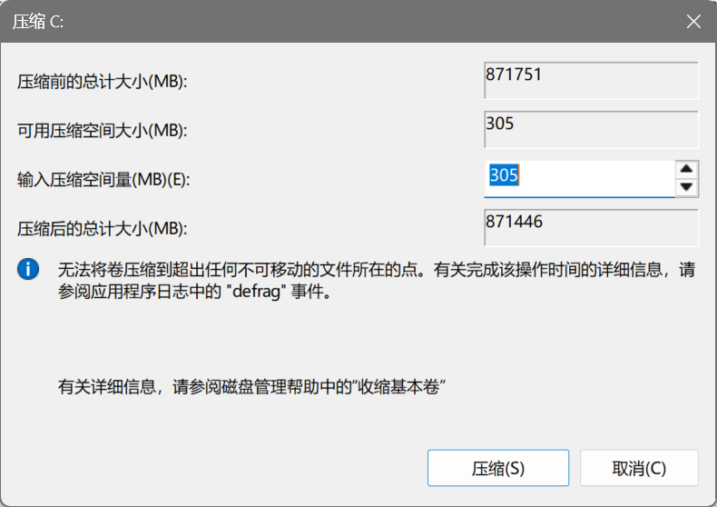
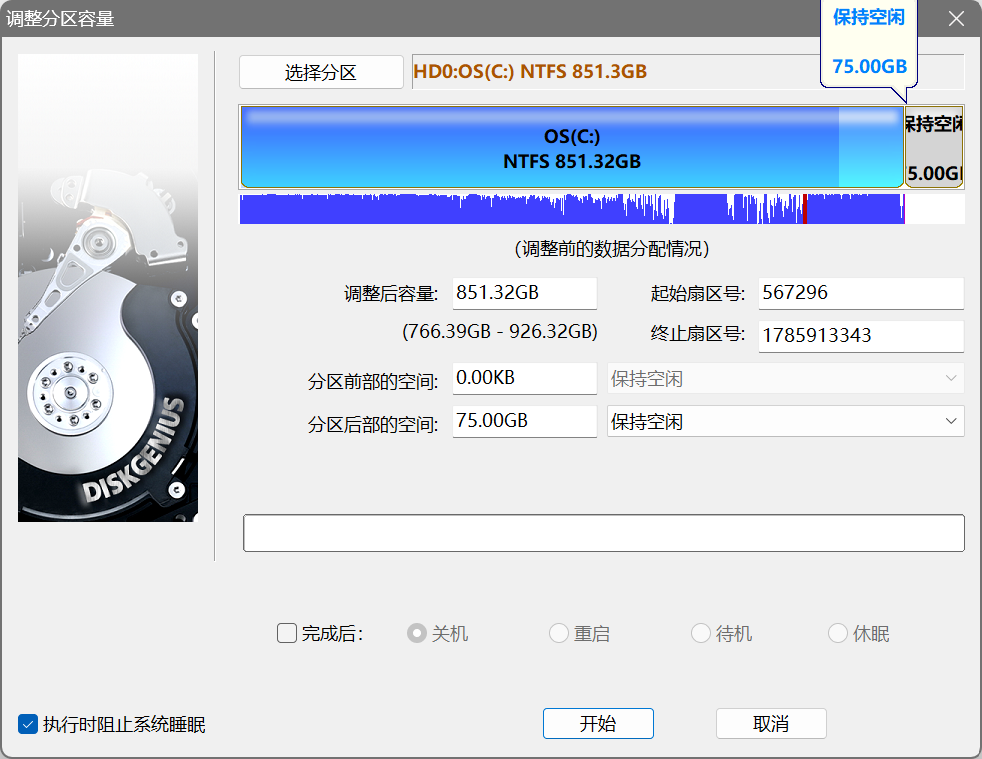
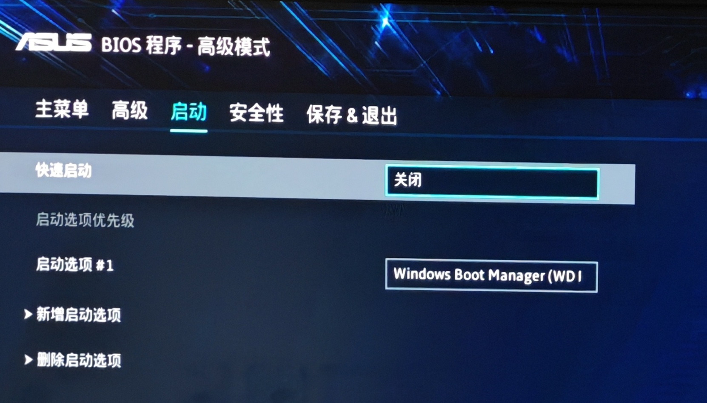
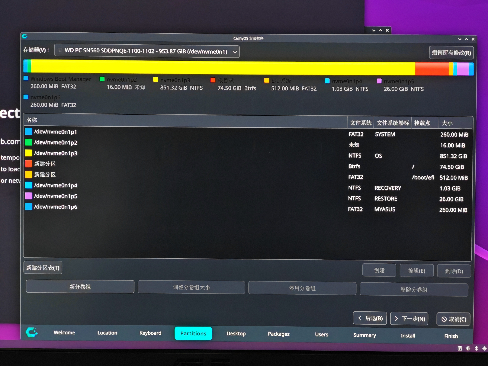

# 引言

本文不是关于 Windows 11 与 CachyOS 双系统的安装的完整教程，而是记录一些在安装前后遇到的问题以及解决方法，仅作为个人参考。

电脑信息：

- 华硕天选 5
- AMD CPU
- NVIDIA 4060 笔记本显卡
- 没有拆分 C 盘分区，只有一个 C 盘存数据与系统


需要下载的资源有：

- [CachyOS ISO 镜像](https://cachyos.org/download/)
- [Ventoy](https://www.ventoy.net/cn/download.html)

把 U 盘用 Ventoy 制作为可引导的 U 盘（ GPT 类型 + exFAT 文件系统），再把 CachyOS ISO 镜像放入 U 盘的根目录中就可以开始了。详细步骤可以参考 [pcdoctor的博客](https://www.cnblogs.com/pcdoctor/p/19462216) 。

# 安装前

## 硬盘分区无法压缩卷

使用 Windows 11 内置的磁盘管理工具，尝试将 C 盘的空间压缩。但是出现错误提示：*无法将卷压缩到超出任何不可移动的文件所在点。有关完成该操作时间的详细信息，参阅应用程序日志中的 “defrag” 事件。*



具体原因不清楚，我尝试了“优化”磁盘，问题也没有解决；最后是通过 [DiskGenius](https://www.diskgenius.cn/) 中的“调整分区容量”来解决。
因为操作了系统分区， DiskGenius 会使用一个 PE 系统来完成操作，大概 10 分钟左右完成。



## 对电脑的调整

> [!NOTE]
> 关于详细的设置可以参考 [W4t3rm310nabc 的博客](https://watermelonabc.top/p/4771a00/#3-%E7%B3%BB%E7%BB%9F%E8%AE%BE%E7%BD%AE)

对 Windows 11 的设置调整为：

- 关闭**快速启动**与**休眠**功能（在 `控制面板\所有控制面板项\电源选项\系统设置` 中关闭）
- 关闭 **BitLocker 加密** 功能（我已经关闭了，找不到相应的入口了，大概是在 `设置\系统\关于\BitLocker`）

对 BOIS 设置（华硕主板需要在 BOIS 中按 `F7` 进入高级模式）调整为：

- 关闭**快速启动**（华硕主板在 `启动` 选项卡中关闭）
- 关闭**安全启动**（华硕主板在 `安全性` 选项卡中关闭，把 *安全启动控制* 关闭再重启电脑即可）
- 关闭 **Intel RST 技术**（如果支持，AMD 不需要）



最后再把启动项改为 U 盘。到这里，全部的配置已完成，可以通过 U 盘进入 Live 环境安装了，注意安装全程需要**保持网络连接。**

# Live 环境中

## 语言

如果你在安装配置的时候选择了用**简体中文**作为新系统的语言，那么 Linux 会“聪明地”把家目录下的文件夹改为中文名，比如“视频”、“下载”、“文档”等。但这对于我们使用命令的时候不方便，因此建议选择**英文**作为新系统的语言，之后进入系统也可以重新调整。

如果你不幸被中文名所困扰，可以查看后文。

## 分区

> [!NOTE]
> 分区部分参考了 [W4t3rm310nabc 的博客](https://watermelonabc.top/p/4771a00/#3-%E5%AE%89%E8%A3%85%E9%85%8D%E7%BD%AE)

因为我们需要 Windows 11 与 CachyOS 共存，需要分开它们的启动分区。
在分区时我们选择手动分区，为 CachyOS 分配一个独立的 boot 分区。

> 启动分区
> - 大小：512MB
> - 文件系统：FAT32
> - 挂载点： `/boot/efi`
> - 标志： *boot*

再创建一个根分区，大小为硬盘中的剩余空间。

> 根分区
> - 大小：剩余空间（> 20000MB）
> - 文件系统：随意，建议 btrfs，参考 [CachyOS 文件系统](https://wiki.cachyos.org/installation/filesystem/)
> - 挂载点： `/`
> - 标志：留空

最后的分区结果如下：



# 安装完成后

## Grub 中未出现 Windows Boot Manager 选项

> [!NOTE]
> 修复 Windows 引导的部分参考了 [Alany 的博客](https://alany.dev/archive/repair-grub-windows-uefi-boot/#:~:text=%E5%80%9F%E5%8A%A9%20grub%20%E4%BF%AE%E5%A4%8D%20Windows%20Boot%20Manager)

在安装完后，重启电脑，发现 Grub 中只有 CachyOS 选项，没有 Windows Boot Manager 选项。

需要修改 Grub 的配置文件，启用 OS Prober。

1. 使用 vim 编辑文件：

    ```bash
    sudo vim /etc/default/grub
    ```

2. 取消注释以下行（如果没有可以自己新添加一行）：

    ```
    GRUB_DISABLE_OS_PROBER=false
    ```

3. 保存并退出 vim 编辑器（ `:wq` ），使用以下的命令更新 Grub 配置文件：

    ```bash
    sudo grub-mkconfig -o /boot/grub/grub.cfg
    ```

4. 重启电脑，发现 Grub 中现在出现了 Windows Boot Manager 选项了。
    通过这个选项进入 Windows 。

## 家目录下文件夹被改为中文

> [!NOTE]
> 本方案参考了 (龙宇翔大佬的博客)[https://longxiucai.github.io/post/13.html]

1. 把这些目录修改为英文名
    ```bash
    mv 下载 Download
    mv 公共 Public
    mv 图片 Picture
    mv 文档 Document
    mv 桌面 Desktop
    mv 模板 Template
    mv 视频 Video
    mv 音乐 Music
    mv 项目 Project
    ```

2. 修改配置文件 `~/.config/user-dirs.dirs`，把以下的路径中文改为英文
    ```
    XDG_DESKTOP_DIR="$HOME/Desktop"
    XDG_DOWNLOAD_DIR="$HOME/Download"
    XDG_TEMPLATES_DIR="$HOME/Template"
    XDG_PUBLICSHARE_DIR="$HOME/Public"
    XDG_DOCUMENTS_DIR="$HOME/Document"
    XDG_MUSIC_DIR="$HOME/Music"
    XDG_PICTURES_DIR="$HOME/Picture"
    XDG_VIDEOS_DIR="$HOME/Video"
    XDG_PROJECTS_DIR="$HOME/Project"
    ```

## 双系统时钟设置

双系统安装好后，你可能会发现，Windows 的时钟错乱了。

> [!NOTE]
> 以下参考了 [Christopher​ 在知乎的回答](https://zhuanlan.zhihu.com/p/492885761)
>
> windows认为，BIOS时间就是当地时间。所以windows会直接显示BIOS时间。
> 
> ubuntu认为，BIOS时间应当是UTC时间（格林尼治标准时间）。所以ubuntu会将BIOS时间加上8小时后再显示出来（在中国）。


直接说解决方法，在 Linux 中输入这个命令

```bash
timedatectl set-local-rtc 1
```

这个命令让 Linux 将系统时间与 BIOS 时间同步。


## niri 下安装 WPS 并配置中文输入法

根据 [WPS ARU](https://wiki.archlinuxcn.org/wiki/WPS_Office?rdfrom=https%3A%2F%2Fwiki.archlinux.org%2Findex.php%3Ftitle%3DWPS_Office_%28%25E7%25AE%2580%25E4%25BD%2593%25E4%25B8%25AD%25E6%2596%2587%29%26redirect%3Dno) 使用 AUR 助手安装 `wps-office-365` 与 `wps-office-mui-zh-cn`

```bash
paru -S wps-office-365 wps-office-mui-zh-cn
```

### WPS 无法打开

如果你和我一样使用 niri 和 dms-shell 有可能也会出现命令行与启动器都无法打开 wps 的情况，

我确定我的电脑安装了 xwayland ，我尝试了以下的命令，这个命令可以绕过 wps 的启动脚本，从而可以让我们看到报错。

```bash 
QT_QPA_PLATFORM=xcb /opt/kingsoft/wps-office/office6/wps
``` 

命令结果为
```
qt.qpa.plugin: Could not find the Qt platform plugin "wayland" in ""
qt.qpa.xcb: could not connect to display :1
qt.qpa.plugin: Could not load the Qt platform plugin "xcb" in "" even though it was found.
This application failed to start because no Qt platform plugin could be initialized. Reinstalling the application may fix this problem.

Available platform plugins are: xcb.
``` 

这个错误信息非常明确，核心问题是：XWayland 未启动 或 缺少加载 xcb 插件所需的系统库。

我使用以下的命令确认我的 xwayland 与 display 正确

```bash
echo $DISPLAY
ps aux | grep Xwayland
``` 

命令的结果如下

``` 
:1   # <- 这一个是出错的根本原因
cc          4875  0.2  0.3 1235776 118624 ?      S<l  7月23   0:04 Xwayland :0 -listenfd 77 -listenfd 47 -rootless -force-xrandr-emulation -wm 7 -displayfd 8 -audit 1 -verbose 0
cc         39069  0.0  0.0  10092  6360 pts/1    S<+  00:24   0:00 grep --color=auto Xwayland
``` 

第一行显示 `$DISPLAY` 被设置为 `:1`，但 xwayland 实际运行在了 `:0`

当我使用以下的命令就可以正常打开 wps

``` bash
DISPLAY=:0 QT_QPA_PLATFORM=xcb wps
``` 

### 修复启动器启动脚本

启动器会读取系统的 .desktop 文件来构建应用列表，所以你只需要确保 用户目录下的 .desktop 文件已正确修改，然后让 dms 重新加载即可。

``` bash
# 1. 表格 (Spreadsheets)
# 复制 .desktop 文件到用户目录下
cp /usr/share/applications/wps-office-et.desktop ~/.local/share/applications/
# 修改 Exec 行，加入变量
sed -i 's|^Exec=.*|Exec=env DISPLAY=:0 QT_QPA_PLATFORM=xcb /usr/bin/et %U|' ~/.local/share/applications/wps-office-et.desktop

# 2. 演示 (Presentation)
cp /usr/share/applications/wps-office-wpp.desktop ~/.local/share/applications/
sed -i 's|^Exec=.*|Exec=env DISPLAY=:0 QT_QPA_PLATFORM=xcb /usr/bin/wpp %U|' ~/.local/share/applications/wps-office-wpp.desktop

# 3. PDF
cp /usr/share/applications/wps-office-pdf.desktop ~/.local/share/applications/
sed -i 's|^Exec=.*|Exec=env DISPLAY=:0 QT_QPA_PLATFORM=xcb /usr/bin/wpspdf %U|' ~/.local/share/applications/wps-office-pdf.desktop

# 4. 文档
cp /usr/share/applications/wps-office-wps.desktop ~/.local/share/applications/
sed -i 's|^Exec=.*|Exec=env DISPLAY=:0 QT_QPA_PLATFORM=xcb /usr/bin/wps %U|' ~/.local/share/applications/wps-office-wps.desktop

``` 

### WPS 在高分屏下 UI 太小

尝试使用了 `QT_SCALE_FACTOR` ，但 WPS 的 QT 库比较旧，无法使用。

需要改用修改启动脚本的方法

``` bash
for cmd in et wpp wpspdf wps; do
    sudo cp /usr/bin/$cmd /usr/bin/$cmd.bak
    sudo sed -i '2i export QT_SCALE_FACTOR=2\nexport QT_FONT_DPI=144' /usr/bin/$cmd
done
``` 
> 把 2 换成你需要的缩放倍数，144 = 96 × 1.5，根据你的屏幕调整。4K 屏通常用 192（96×2）。

### WPS 下使用 fcitx5 中文输入法

> [!NOTE]
> 参考 [星外之神 Blog](https://wszqkzqk.github.io/2024/03/09/WPS-Fcitx5/)

原博主把 `/usr` 下的 WPS `.desktop` 文件都复制到了用户目录下。
**这里我在之前做过了，所以这里没有执行这个命令**

``` bash
cp /usr/share/applications/wps-office*.desktop ~/.local/share/applications/
``` 

为每一个 `~/.local/share/applications/wps-office*.desktop`
文件中的 `Exec` 行的 `env` 后都添加以下的语句

```bash
XMODIFIERS="@im=fcitx" GTK_IM_MODULE="fcitx" QT_IM_MODULE="fcitx" SDL_IM_MODULE=fcitx GLFW_IM_MODULE=ibus
``` 

经过以上的步骤，这一行都会被改为：

```
# wps-office-wps.desktop
Exec=env DISPLAY=:0 QT_QPA_PLATFORM=xcb XMODIFIERS="@im=fcitx" GTK_IM_MODULE="fcitx" QT_IM_MODULE="fcitx" SDL_IM_MODULE=fcitx GLFW_IM_MODULE=ibus /usr/bin/wps %U

# wps-office-et.desktop
Exec=env DISPLAY=:0 QT_QPA_PLATFORM=xcb XMODIFIERS="@im=fcitx" GTK_IM_MODULE="fcitx" QT_IM_MODULE="fcitx" SDL_IM_MODULE=fcitx GLFW_IM_MODULE=ibus /usr/bin/et %U

# wps-office-pdf.desktop
Exec=env DISPLAY=:0 QT_QPA_PLATFORM=xcb XMODIFIERS="@im=fcitx" GTK_IM_MODULE="fcitx" QT_IM_MODULE="fcitx" SDL_IM_MODULE=fcitx GLFW_IM_MODULE=ibus /usr/bin/wpspdf %U

# wps-office-wpp.desktop
Exec=env DISPLAY=:0 QT_QPA_PLATFORM=xcb XMODIFIERS="@im=fcitx" GTK_IM_MODULE="fcitx" QT_IM_MODULE="fcitx" SDL_IM_MODULE=fcitx GLFW_IM_MODULE=ibus /usr/bin/wpp %U

```